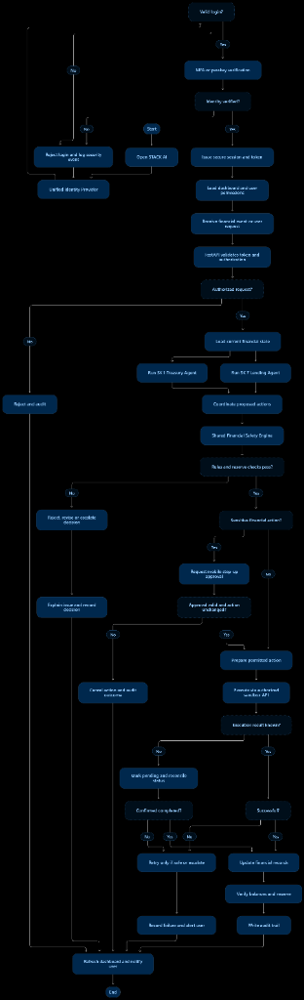
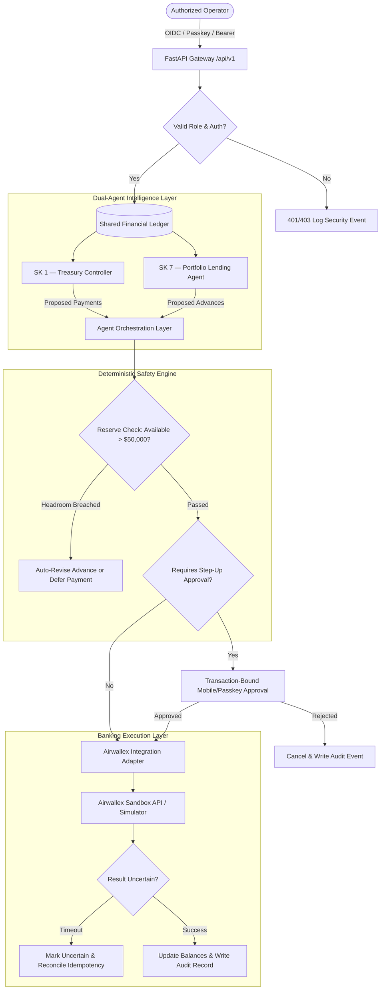

<div align="center">

# Airwallex-agentic-bank

<a href="https://git.io/typing-svg"></a>

<p align="center">
  <strong>STACK AI — Treasury • Lending • Risk</strong><br>
  <em>A unified multi-agent financial intelligence platform coordinating real-time cash management and revenue-based portfolio lending over a deterministic financial safety engine.</em>
</p>

[](https://python.org)
[](https://fastapi.tiangolo.com)
[](https://nextjs.org)
[](https://typescriptlang.org)
[](https://tailwindcss.com)
[-brightgreen?logo=pytest&logoColor=white)](https://pytest.org)
[](https://www.airwallex.com/docs)

</div>

---

## 📌 Executive Summary

Modern businesses struggle with disconnected treasury operations and credit facilities. If an autonomous treasury agent schedules supplier disbursements while a lending agent simultaneously approves an advance facility, uncoordinated execution can instantly breach minimum liquidity reserves.

**STACK AI** resolves this structural failure mode through an **orchestrated dual-agent platform** connected to a shared financial state and guarded by a **Deterministic Financial Safety Engine**:

1. **SK 1 — Adaptive Treasury Controller:** Analyzes available cash, monitors upcoming critical obligations (payroll, suppliers, tax), prioritizes outgoing disbursements, and forecasts liquidity stress.
2. **SK 7 — Portfolio Lending Agent:** Evaluates borrower revenue receipts, calculates revenue-based repayments (RBF), measures portfolio exposure, and assesses safe advance requests.
3. **Deterministic Financial Safety Engine:** A mathematically rigorous verification layer built with Python `Decimal` arithmetic that guarantees the **$50,000.00 Protected Minimum Cash Reserve** is never breached by any combination of actions.

---

## 🏗 System Architecture & Workflow

<div align="center">
  
</div>

### Multi-Agent Coordination Protocol



---

## 🛡 Deterministic Financial Safety Engine Invariants

The core innovation is that **AI agents cannot directly manipulate ledgers or execute disbursements**. All proposed actions pass through our pure Python engine:

- **Invariant 1: Available Cash Non-Negative:** $\text{Available Cash} = \max(0, \text{Total Cash} - \text{Committed} - \text{Reserve})$
- **Invariant 2: Reserve Inviolability:** No approved transaction or combination of actions may reduce liquidity below $\$50,000.00$.
- **Invariant 3: Idempotent Execution:** Every payment and disbursement requires a unique idempotency key. Duplicate submissions return the original state without double-execution.
- **Invariant 4: Revenue-Linked Sweeps:** Repayments are strictly calculated from verified receipts: $\text{Sweep} = \text{Revenue} \times \text{Percentage}$.
- **Invariant 5: Canonical Step-Up Approval:** Actions exceeding $\$10,000$ bind to a canonical SHA-256 hash preventing replay or modification.

---

## 🎨 Visual Interface (Matched to Design Reference)

The web dashboard is built in **Next.js 14 (App Router)** with a Bloomberg-grade dark navy palette (`#0a0f1e` / `#0f172a` / `#1e293b`):

- **Row 1 — KPI Metrics:** Total Cash Balance (`$142,380.00`), Reserved Amount (`$35,000.00`), Available for Lending (`$57,380.00`), Outstanding Loans (`$60,200.00`), and Expected Repayments (`$15,040.00`).
- **Row 2 — Financial Visualizations:** Interactive Recharts Cash Flow Area Chart (Historical vs. Projected series) and Portfolio Health Donut Chart.
- **Row 3 — Core Ledgers:** Upcoming Obligations Table with dynamic priority tags (`critical`, `high`, `medium`) and Lending Portfolio Table with real-time risk indicators.
- **Right Panel — STACK AI Telemetry:** Revenue delay warnings (TechFlow missed payment, GreenLeaf revenue delay), lending opportunities, and recent actions.
- **Bottom Section — Coordinated Recommendation:** Real-time demonstration of the GreenLeaf $15,000 advance request automatically revised down to **$7,480.00** to safeguard the reserve.

---

## 🚀 Getting Started

### Prerequisites

- **Python 3.12+** (tested and verified on Python 3.14)
- **Node.js 18+** / **npm 10+** (tested on Node v25.2.1)
- Optional: **Docker & Docker Compose**

### 1. Backend Setup

```bash
cd backend

# Create virtual environment (optional)
python -m venv venv
# Windows:
.\venv\Scripts\activate
# Linux/macOS:
source venv/bin/activate

# Install requirements
pip install -r requirements.txt

# Seed the database with synthetic demo scenarios
python -m app.demo.seed

# Start the FastAPI server (runs on http://localhost:8000)
uvicorn app.main:app --host 127.0.0.1 --port 8000 --reload
```

Interactive API documentation will be available at:
- Swagger UI: `http://localhost:8000/api/docs`
- ReDoc: `http://localhost:8000/api/redoc`
- Health Endpoint: `http://localhost:8000/api/v1/health`

### 2. Frontend Setup

```bash
cd frontend

# Install dependencies
npm install --legacy-peer-deps

# Build production bundle
npm run build

# Start local server (runs on http://localhost:3000)
npm run dev
```

Visit **`http://localhost:3000`** in your browser.

---

## 🧪 Automated Test Suite (24 Test Cases + Hypothesis Fuzzing)

Run the full pytest suite:

```bash
cd backend
python -m pytest tests/test_safety_engine.py -v
```

### Verified Test Cases:
1. `test_valid_monetary_amount` — Valid monetary decimal parsing
2. `test_invalid_monetary_amount_zero` — Zero values rejected
3. `test_invalid_monetary_amount_negative` — Negative values rejected
4. `test_invalid_monetary_amount_text` — Non-numeric strings rejected
5. `test_invalid_monetary_amount_none` — Null values rejected
6. `test_reserve_enforced_on_advance` — Advance breaching reserve revised/rejected
7. `test_reserve_not_breached_on_safe_advance` — Safe advance under threshold approved
8. `test_critical_payment_warning_not_violation` — Critical priority escalates without crash
9. `test_low_priority_payment_violation_on_breach` — Low priority payment rejected on breach
10. `test_revenue_repayment_calculation` — Exact percentage revenue calculation
11. `test_revenue_repayment_rounds_to_cent` — Cent rounding invariant
12. `test_revised_repayment_after_revenue_drop` — Revenue shock proportional scaling
13. `test_idempotency_key_uniqueness` — Replay attack prevention
14. `test_invalid_repayment_percentage_zero` — Boundary check: 0% rejected
15. `test_invalid_repayment_percentage_above_one` — Boundary check: >100% rejected
16. `test_available_cash_calculation` — Headroom math verification
17. `test_available_cash_never_negative` — Non-negative available cash guarantee
18. `test_max_advance_is_available_minus_reserve` — Exact maximum advance calculation
19. `test_advance_above_max_is_revised` — Automatic ceiling clamping
20. `test_safety_engine_is_deterministic` — AI suggestions overridden by deterministic rules
21. `test_pending_payments_reduce_available` — Combined commitment deduction
22. `test_large_advance_requires_approval` — Two-party policy trigger
23. `test_small_advance_no_approval_required` — Micro-advance threshold
24. `test_fuzz_advance_safety` — **Hypothesis 100-iteration random fuzz testing**

---

## 📡 API Reference Overview

| Method | Endpoint | Description |
|---|---|---|
| `GET` | `/api/v1/health` | Service health & database connectivity status |
| `POST` | `/api/v1/auth/login` | OIDC/JWT login endpoint |
| `GET` | `/api/v1/dashboard` | Aggregated KPI metrics, portfolio health, obligations & recs |
| `GET` | `/api/v1/accounts` | Multi-account balances (Operating, Lending Pool, Reserve) |
| `GET` | `/api/v1/cashflow` | 12-month historical + 3-month forecast cashflow points |
| `GET` | `/api/v1/obligations` | Upcoming supplier, payroll, and tax payment ledger |
| `GET` | `/api/v1/payments` | Paginated transaction ledger with idempotency keys |
| `GET` | `/api/v1/loans` | Active lending portfolio & borrower exposures |
| `GET` | `/api/v1/repayments` | Revenue-linked sweep performance and records |
| `POST` | `/api/v1/treasury/analyze` | Run SK 1 Adaptive Treasury Controller |
| `POST` | `/api/v1/lending/assess` | Run SK 7 Portfolio Lending Agent advance assessment |
| `POST` | `/api/v1/scenarios/simulate` | Stress simulation (e.g. -30% revenue drop) |
| `GET` | `/api/v1/approvals` | List pending transaction-bound approval requests |
| `POST` | `/api/v1/approvals/{id}/approve` | Confirm step-up approval with SHA-256 validation |
| `POST` | `/api/v1/approvals/{id}/reject` | Reject proposed financial action |
| `POST` | `/api/v1/assistant/chat` | AI Assistant query interface with structured calculation output |

---

## 📦 Docker Deployment

```bash
# Start full stack (PostgreSQL, Redis, FastAPI Backend, Next.js Frontend)
docker-compose up --build
```

---

## 📄 License & Attribution

Built for the **Airwallex Agentic Bank Hackathon (SK 1 + SK 7)**.  
All demonstration financial figures, company identities, and transaction statements are synthetic demo fixtures.
